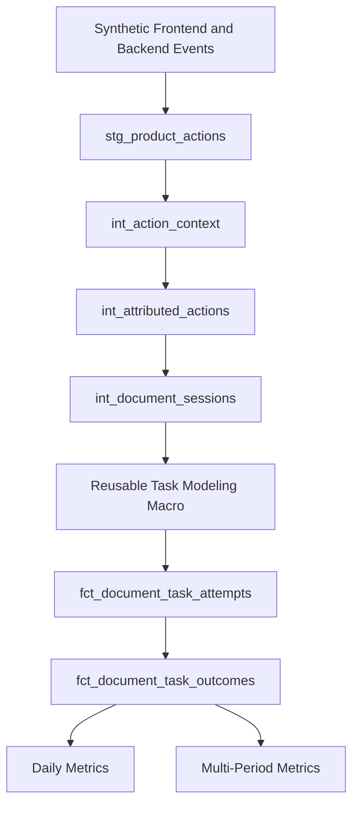

# Product Analytics Engineering
### Event-to-Workflow Data Modeling with dbt & DuckDB

Transforming fragmented product events into reliable, reusable data models and consistent product metrics.

**Tech stack:** dbt Core | DuckDB | SQL | Jinja | Git

**Project type:** Independent technical portfolio project using entirely synthetic data.

## The Problem

Product analytics becomes difficult when:

- Behavioral events originate from different systems.
- Events lack critical business entity identifiers.
- Meaningful workflows are not explicitly instrumented.
- Activity on the same document can occur in distinct sessions.
- Product teams need consistent metrics across features and reporting periods.

Without a shared modeling foundation, analysts must repeatedly reconstruct business logic from raw events, creating duplicated SQL and inconsistent metrics.

## The Solution

This project demonstrates a reusable analytics engineering framework that:

1. Standardizes heterogeneous event data.
2. Infers missing document identifiers using surrounding event context.
3. Reconstructs document-level sessions across event sources.
4. Derives task attempts from granular actions.
5. Classifies completed, failed, incomplete, and presumed-abandoned workflows.
6. Produces consistent daily, weekly, monthly, and quarterly metrics.

The objective is to move complexity into reusable data models so downstream users can access reliable product metrics without rebuilding the underlying logic.

## Data Architecture



The source data is a single synthetic CSV that simulates frontend and backend events. It is not an implementation of multiple production ingestion pipelines.

## Key Modeling Decisions

### 1. Context-Based Entity Attribution

Some events are missing a document identifier.

Rather than discarding these events, the attribution model examines known document IDs in preceding and following events within the same account and device.

An ID is inferred when:
- The surrounding known document IDs agree.
- Both surrounding events fall within a 60-second window.

The model preserves the original document ID alongside the resolved ID and an attribution method: `direct`, `inferred`, or `unresolved`.

When surrounding identifiers conflict, the current implementation leaves the event unresolved rather than assigning an unsupported match.

**Design principle:** Inferred relationships should remain distinguishable from directly observed relationships.

### 2. Cross-Source Sessionization

Events are grouped by account and resolved document identifier, regardless of their original event source.

SQL window functions identify inactivity gaps exceeding 10 minutes. A cumulative session counter then assigns each event to a document-level session.

This allows the model to reconstruct continuous activity across frontend and backend events.

**Design principle:** Session boundaries should reflect the business entity being analyzed rather than depend solely on source-system session definitions.

### 3. Task-Attempt Modeling

Individual events do not necessarily correspond to meaningful business workflows.

The task-modeling layer groups actions into attempts and identifies:
- First and last observed activity
- Completion and failure signals
- Number of activity actions
- Observed activity span
- Elapsed time to completion

Multiple task attempts can occur within a single document session.

An auxiliary model illustrates inferred activity boundaries, while task-attempt durations use observed qualifying event timestamps. Inferred boundaries should not be mistaken for precisely observed workflow start or end times.

### 4. Reusable dbt Macros

The project separates workflow definitions from transformation logic.

The `task_action_condition` macro defines qualifying actions for each workflow.

The `build_task_attempts` macro generates standardized task records for multiple workflows using shared SQL.

Currently supported workflows:
- `document_editing`
- `document_review`

This design reduces duplicated SQL and makes the framework easier to extend.

**Design principle:** New workflows can be introduced by extending centralized action definitions and reusing the shared transformation logic.

### 5. Consistent Metrics Across Reporting Periods

The `aggregate_task_metrics` macro generates metrics for four reporting granularities:

- Daily
- Weekly
- Monthly
- Quarterly

Metrics include task attempts, outcome counts, completion rates, failure rates, presumed-abandonment rates, and average completion duration.

Each reporting period aggregates from task-level records rather than averaging previously aggregated percentages.

**Design principle:** Shared metric definitions should produce consistent results regardless of reporting granularity.

## Project Structure

```text
README.md
docs/
├── 001-sessionization.md
└── 002-metric-definitions.md
ae_product/
├── seeds/
│   └── product_actions.csv
├── models/
│   ├── staging/
│   ├── intermediate/
│   └── marts/
│       ├── fct_document_task_attempts.sql
│       ├── fct_document_task_outcomes.sql
│       ├── agg_document_tasks_daily.sql
│       ├── agg_document_tasks_by_period.sql
│       └── _unit_tests.yml
├── macros/
│   ├── task_action_condition.sql
│   ├── build_task_attempts.sql
│   └── aggregate_task_metrics.sql
└── tests/
```

## Data Quality and Validation

The project includes automated tests for:

- Event ID uniqueness and completeness
- Valid attribution methods
- Known entity-attribution scenarios
- Session boundary assignments
- Multiple task attempts within a session
- Consistency between original and generalized task models
- Reconciliation of daily metrics to task records
- Reconciliation across reporting periods
- Metric-rate and duration integrity
- Duplicate-completion handling through a dbt unit test

The latest full build loaded 31 synthetic events, built 10 models, and passed all 13 automated tests (12 data tests and 1 unit test). All 24 build steps completed without warnings or errors.

## Supporting Documentation

- [Sessionization Architecture Decision Record](docs/001-sessionization.md) — Design rationale, late-arriving events, and session-ID stability.
- [Metric Definitions and Reporting Assumptions](docs/002-metric-definitions.md) — Outcome classifications, metric formulas, reporting grains, and limitations.

## Example: Self-Service Metrics

A downstream analyst or BI tool can query monthly task metrics without reconstructing the underlying event streams:

```sql
select
    period_start,
    task_name,
    task_attempts,
    completion_rate_pct,
    avg_completion_seconds
from agg_document_tasks_by_period
where reporting_period = 'month'
order by period_start, task_name;
```

## Running the Project

This project uses dbt Core and DuckDB.

Install the DuckDB adapter in a Python environment:

```bash
python -m pip install dbt-duckdb
```

Configure a local dbt profile named `ae_product` in `~/.dbt/profiles.yml`:

```yaml
ae_product:
  target: dev
  outputs:
    dev:
      type: duckdb
      path: dev.duckdb
      threads: 1
```

Then run:

```bash
cd ae_product
dbt debug
dbt build
```

The build loads the synthetic source data, creates the models, and executes automated tests.

## Limitations and Future Improvements

This is a compact demonstration of analytics engineering design principles, not a production deployment.

Important limitations include:

- Entity attribution uses a conservative contextual matching rule and does not resolve all ambiguous cases.
- The sample data simulates different event sources rather than implementing independent ingestion pipelines.
- Session identifiers based on chronological sequence numbers may change when historical events arrive late.
- Task-attempt logic ignores consecutive terminal events without intervening activity. Overlapping workflows and more complex duplicate-event patterns would require additional business rules.
- Document rejection is defined as a failed review for this demonstration, although a real product might classify it as a completed review with a rejected decision.
- Presumed abandonment is inferred using a 10-minute inactivity threshold and the latest event timestamp in the dataset. It is not directly observed user behavior.
- Additional tests would be required before applying these models to production event streams.

Potential future enhancements include configurable inactivity thresholds, more comprehensive instrumentation checks, incremental processing, and stronger validation of delayed or out-of-order events.

## Project Context

This independent project is informed by professional experience implementing reusable product analytics data models.

All data is synthetic, and the SQL, macros, workflow definitions, and examples were created independently for this portfolio.

No former employer's proprietary code, internal datasets, or implementation documentation are included.
